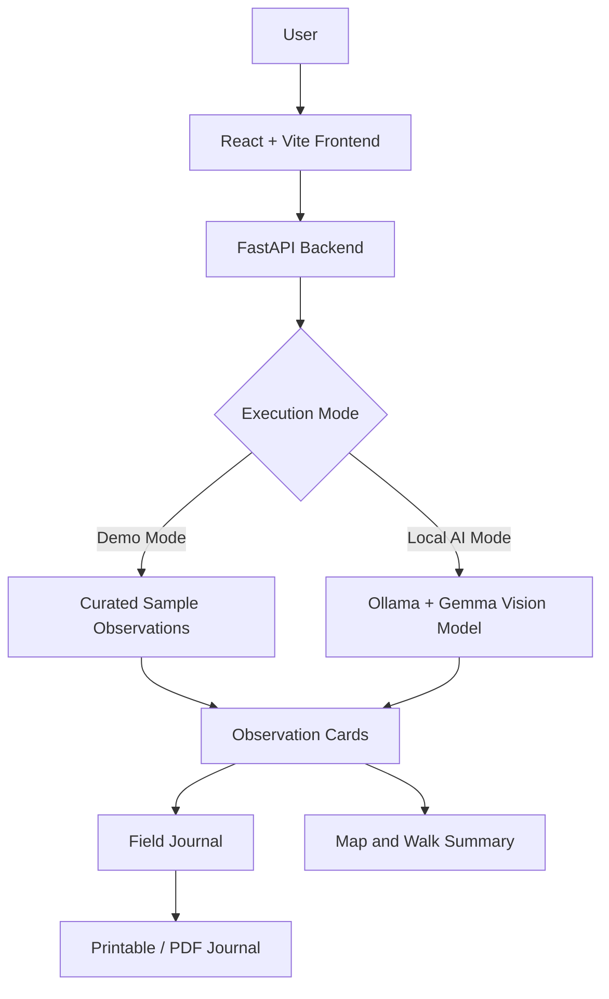

# 🌿 WalkAround — Touch Grass, One Discovery at a Time

> **Put your phone away. Look closer. Discover the nature around you.**

WalkAround is an AI-powered nature journaling application that encourages mindful outdoor exploration. Capture interesting plants, fungi, and wildlife, learn about your surroundings using locally running Google Gemma vision AI, and preserve your discoveries in a personal field journal.

Built for the **Hacktoberfest 2026 — Week 1 “Touch Grass” Challenge**.

<p align="center">
  <a href="https://walkaround-frontend.onrender.com"><strong>🌐 Try the Live Demo</strong></a>
  &nbsp; • &nbsp;
  <a href="https://github.com/Aryan21-Sutariya/WalkAround"><strong>💻 Source Code</strong></a>
</p>

---

## 🌱 The Idea

Smartphones often distract us from the world immediately around us. Even when we go outside, we may spend more time looking at a screen than observing nature.

**WalkAround flips that experience around.**

Instead of endlessly scrolling, users step outside, notice something interesting, capture it when needed, and build a journal of their discoveries.

The goal is simple: use AI as a tool to encourage real-world curiosity, not as another reason to stay glued to a screen.

## ✨ Features

- **📸 Capture & Upload:** Take a photo of a plant, fungus, or animal using your camera, or upload an existing image.
- **🧠 Local Gemma Vision AI:** Analyze specimen images using Google's open-weight Gemma model through Ollama on your own machine.
- **⚡ Instant Demo Mode:** Explore curated nature observations on the hosted demo without waiting for local model inference.
- **📖 Digital Field Journal:** Save observations and revisit your nature discoveries.
- **🗺️ Map Your Discoveries:** View observation markers and explore where discoveries were recorded.
- **🥾 Walk Summary:** Review your observations and compile a summary of your walk.
- **📄 Downloadable Field Journal:** Generate a printable field journal or save it as a PDF through your browser's print dialog.
- **🎨 Nature-Inspired Interface:** A warm, paper-cut visual design inspired by illustrated field journals and the outdoors.

## 🚀 Try WalkAround

**Live application:** https://walkaround-frontend.onrender.com

The hosted version uses Demo Mode so that visitors can explore the experience without installing an AI model.

Sample observations include:

| Specimen | Scientific name |
|---|---|
| Wood Fern | *Dryopteris carthusiana* |
| Turkey Tail Fungus | *Trametes versicolor* |
| Honey Bee on Clover | *Apis mellifera* |
| Oak Lichen | Curated lichen observation |

**Important:** Demo Mode displays curated sample observations. It does not claim to identify or analyze the visitor's uploaded image. For image-based AI inference, run WalkAround locally with Gemma and Ollama.

## 🧠 Two Ways to Explore

### 1. Local AI Mode — Powered by Gemma

Run WalkAround on your computer to use a locally hosted vision model.

- Uses Google's open-weight Gemma model through Ollama.
- Processes images locally for model inference.
- Does not require a paid cloud AI API for the local inference workflow.
- Uses image resizing and JPEG compression to reduce the amount of data sent to the model.

**Requirements:** Python, Node.js, Ollama, and the configured `gemma4:e2b` model.

Local inference speed depends on your hardware. CPU-only systems may take considerably longer than systems with suitable acceleration.

### 2. Public Demo Mode — Powered by Render

The hosted application uses a FastAPI backend configured with `DEMO_MODE=true`.

- No Ollama installation is required for visitors.
- Curated observations appear without waiting for local model inference.
- The frontend and backend are deployed as separate Render services.
- Demo observations are explicitly presented as samples.

This separation makes the project easy to try while keeping the local AI workflow available for users who want to experiment with image analysis.

## 🏗️ Architecture



### Technology Stack

| Layer | Technologies |
|---|---|
| Frontend | React, JavaScript, Vite |
| Backend | Python, FastAPI |
| Vision AI | Google Gemma via Ollama |
| Image processing | Pillow |
| Hosting | Render Web Service and Static Site |
| Development | Git and GitHub |

## 🛠️ Run Locally

### Prerequisites

Install Python, Node.js/npm, and [Ollama](https://ollama.com/).

### 1. Clone the repository

```bash
git clone https://github.com/Aryan21-Sutariya/WalkAround.git
cd WalkAround
```

### 2. Start the backend

Create and activate a virtual environment.

**Windows PowerShell:**

```powershell
cd backend
python -m venv venv
.\venv\Scripts\Activate.ps1
pip install -r requirements.txt
```

**macOS/Linux:**

```bash
cd backend
python -m venv venv
source venv/bin/activate
pip install -r requirements.txt
```

Start the API:

```bash
uvicorn main:app --reload --port 8000
```

Backend health check: http://127.0.0.1:8000/api/health

### 3. Configure local AI mode

In another terminal, ensure Ollama is running and pull the configured model:

```bash
ollama pull gemma4:e2b
```

Set `DEMO_MODE=false` in the backend environment configuration used by your project, then restart the backend.

If the model is unavailable or inference is slow, check the backend logs and your local Ollama setup.

### 4. Start the frontend

Open a new terminal:

```bash
cd frontend
npm install
npm run dev
```

Open the local URL printed by Vite, typically http://localhost:5173.

**For a quick UI walkthrough:** use the backend's Demo Mode instead of local model inference.

## ☁️ Deployment with Render

The repository includes a root-level `render.yaml` Blueprint for deploying both application services.

1. Push the repository to GitHub.
2. Open the [Render Dashboard](https://dashboard.render.com/).
3. Choose **New + → Blueprint**.
4. Select `Aryan21-Sutariya/WalkAround` and the `main` branch.
5. Use the root-level `render.yaml` configuration.
6. Deploy the Blueprint and wait for both services to become healthy.

The Blueprint configures:

- **`walkaround-backend`** — Python web service running FastAPI with `DEMO_MODE=true`.
- **`walkaround-frontend`** — Static site built from the React/Vite application.

The frontend's `VITE_API_URL` references the backend service. Because Vite environment variables are embedded during the build, changes to this variable require a new frontend build/deployment.

The live deployment is available at https://walkaround-frontend.onrender.com.

*Free-tier services may sleep when idle and take time to wake up. Availability and resource limits are controlled by Render.*

## 🧪 Testing

### Backend

From the repository root, activate the backend virtual environment and run:

```bash
python backend/test_api.py
```

This test script is intended to check the backend API and its supported validation and demo workflows.

### Frontend production build

```bash
cd frontend
npm run build
```

This verifies that the frontend can be compiled for production.

Run both checks after making changes to help catch regressions before pushing to GitHub.

## 🔒 Privacy, Transparency & Limitations

- **Local inference:** Image-based inference runs through the locally configured Ollama model.
- **Demo transparency:** Curated sample observations are not represented as results from analyzing the visitor's uploaded image.
- **AI limitations:** Model-generated species descriptions and identifications can be inaccurate. Treat them as exploratory suggestions, not verified scientific identification.
- **Performance:** Local inference speed varies by hardware.
- **Location data:** Map functionality depends on the application's configured location and observation data. Do not assume precise GPS tracking unless it is explicitly enabled and verified.
- **Hosted mode:** The public demo prioritizes accessibility and responsiveness over live image inference.

## 💡 Open Innovation

WalkAround combines an open-weight vision model with a lightweight web application to make AI-assisted nature exploration more accessible.

The project explores a practical alternative to cloud-only AI inference: let users experiment with a locally running model while providing a fast, clearly labeled hosted demo for everyone else.

Its broader idea is that technology can encourage people to step away from their screens, observe their surroundings, and build a stronger connection with the natural world.

## 🗺️ Roadmap

Potential future improvements include:

- More robust species identification and confidence communication.
- Better handling of uncertain or ambiguous observations.
- Improved walk history and journal organization.
- Additional offline-friendly features.
- More accessible nature education and observation workflows.

## 📜 License

This project is released under the MIT License. See [`LICENSE`](LICENSE) for details.

---

**Take a walk. Notice something small. Let curiosity lead the way. 🌿**

Built with curiosity for Hacktoberfest 2026.
